<p align="center">
  
</p>

<h1 align="center">NotchHub</h1>

<p align="center">
  <b>Your MacBook notch, turned into a live control center.</b><br>
  Music, meetings, files, timers and alerts, one hover away.
</p>

<p align="center">
  <a href="https://github.com/atak946/NotchHub/releases/latest"></a>
  
  
  <a href="LICENSE"></a>
  <a href="https://github.com/atak946/NotchHub/actions/workflows/ci.yml"></a>
  <a href="https://github.com/atak946/NotchHub/releases"></a>
</p>

<p align="center">
  <a href="https://github.com/atak946/NotchHub/releases/latest">
    
  </a>
</p>

<p align="center">
  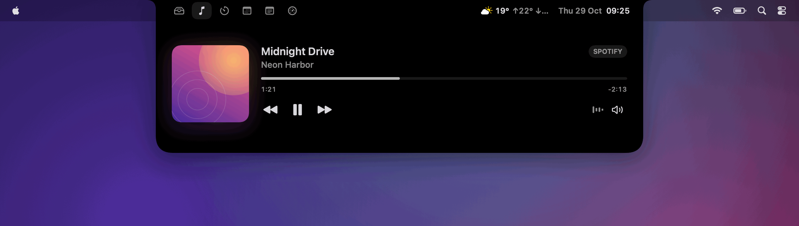
</p>

<p align="center">
  <b>English</b> · <a href="README.tr.md">Türkçe</a>
</p>

---

## ✨ At a glance

Hover the notch and NotchHub opens. Move away and it closes. While it is closed, small live indicators sit
beside the notch. Press `⌥⌘N` to toggle it and `⌘1…6` to switch tabs. Displays without a notch get a virtual
one.

<table>
  <tr>
    <td width="50%" valign="top">
      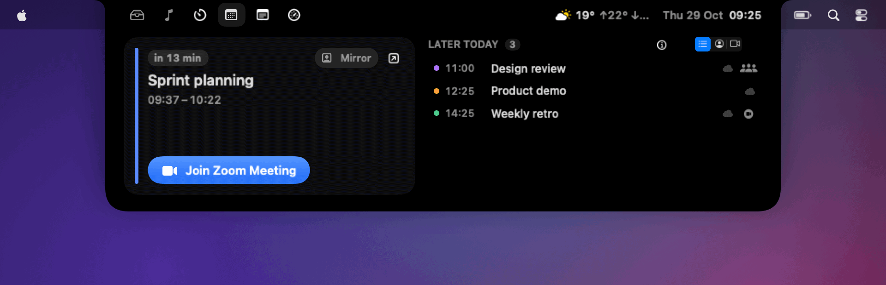
      <h3>📅 Calendar</h3>
      The next meeting with a one-click Zoom / Teams / Meet join button, plus the rest of today.
      macOS Calendar, ICS feeds and Microsoft 365.
    </td>
    <td width="50%" valign="top">
      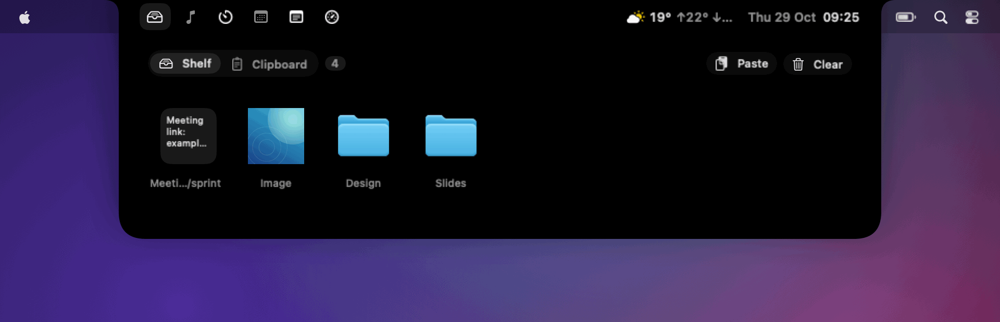
      <h3>🗂️ File shelf</h3>
      Drop files, text or images onto the notch and drag them out later. Quick Look, AirDrop and a
      clipboard history are built in.
    </td>
  </tr>
  <tr>
    <td width="50%" valign="top">
      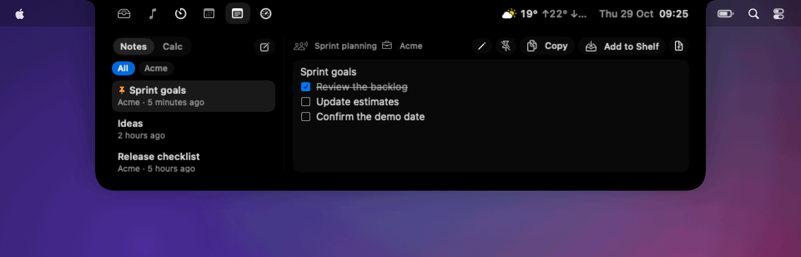
      <h3>📝 Notes &amp; quick calc</h3>
      Plain-text notes with checklists that pick up the current meeting and client. A calculator with
      unit and currency conversion sits next door.
    </td>
    <td width="50%" valign="top">
      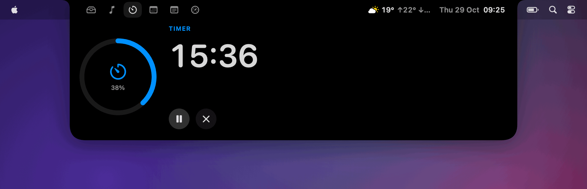
      <h3>⏱️ Timer &amp; Pomodoro</h3>
      Presets, custom timers and Pomodoro cycles, with the countdown shown beside the closed notch.
    </td>
  </tr>
  <tr>
    <td width="50%" valign="top">
      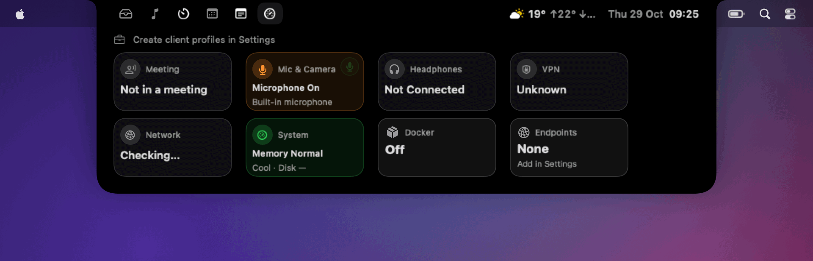
      <h3>📡 Status</h3>
      Microphone and camera in use, VPN, network, memory and thermal pressure, Docker, endpoints and a
      local LLM server.
    </td>
    <td width="50%" valign="top">
      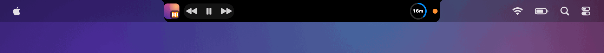
      <h3>🎵 Alive while closed</h3>
      Artwork with a tinted visualizer, playback controls, the timer and the privacy dot, right beside the
      notch.
    </td>
  </tr>
</table>

### 🔔 Notifications that respect your privacy

Message banners can be mirrored into the notch. Message text can stay hidden until you press **Show**.

<p align="center">
  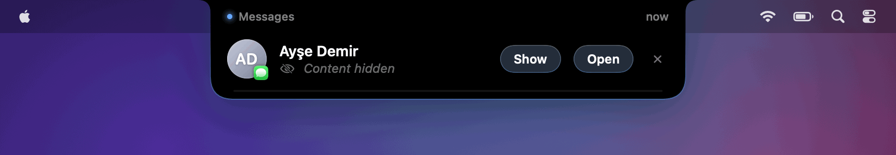
  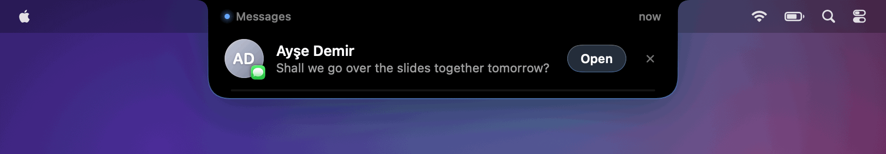
</p>

### 🔋 Battery and volume, the notch way

Charging, unplugging and low battery show up as small animated alerts. The volume and brightness HUD
replaces the big system overlay.

<p align="center">
  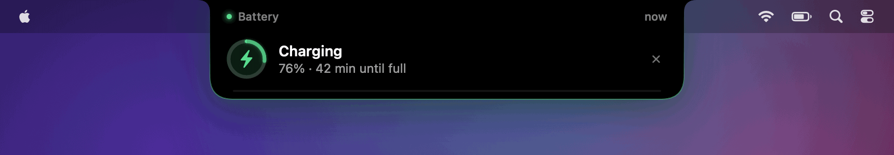
  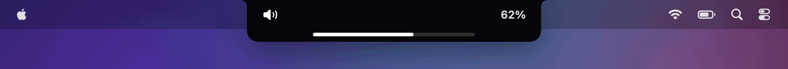
</p>

### ⚙️ Settings you can search

Every option lives in one searchable window. Type a word and matching pages and options appear.

<p align="center">
  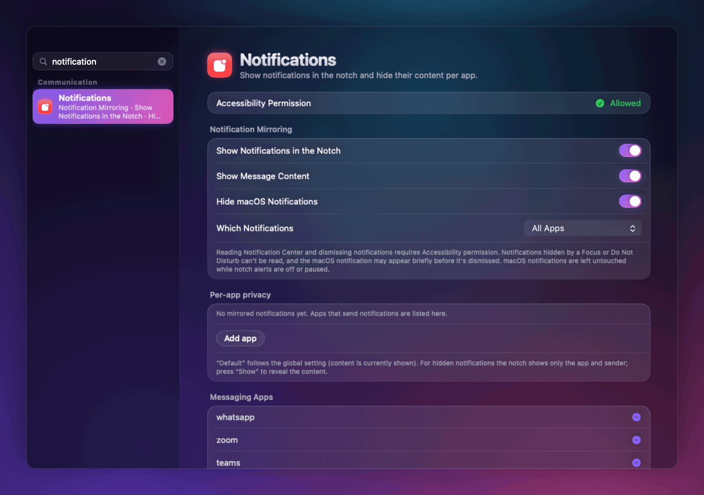
</p>

### 🧰 And more

- **Animated alerts:** one queue for reminders, timers, system events and your own scripts.
- **Profiles:** one-click client profiles that open apps and URLs, wait for the VPN and run `docker compose`.
- **Insights:** unread badges, per-client time tracking and a focus guard.
- **Integrations:** a `notchhub://` URL scheme, a local socket, a CLI, a zsh hook and Xcode build alerts.
- **Weather** beside the clock, and a **camera mirror** before video calls.

The full list is in [docs/FEATURES.md](docs/FEATURES.md) (Turkish).

## 📦 Install

1. Download the latest **NotchHub.dmg** from [Releases](https://github.com/atak946/NotchHub/releases/latest).
2. Open it and drag **NotchHub** to **Applications**.
3. Launch NotchHub. It lives in the menu bar and has no Dock icon.

Releases are signed and notarized by Apple. NotchHub checks for updates once a day with
[Sparkle](https://sparkle-project.org) and offers them in the notch. Every update is verified with an EdDSA
signature. You can turn the check off in Settings.

**Requirements:** macOS 26 or later. A Mac with a notch is recommended.
The app is available in English and Turkish.

## 🔐 Permissions

macOS asks for each permission the first time a feature needs it. If you decline one, only that feature
stays off.

| Permission | Why NotchHub asks |
|---|---|
| **Calendars** | Next meeting, today's agenda and meeting reminders |
| **Automation** (Apple Events) | Reading and controlling Spotify and Music |
| **Notifications** | Timer and Pomodoro notifications |
| **Accessibility** | Dock unread badges, window titles for time tracking, and reading (and optionally closing) notification banners for mirroring |
| **Location** (optional) | Weather for your current city (or pick a city instead), and the Wi-Fi name for network-change alerts |
| **Login item** | "Launch at login" |

Microphone and camera *use* is detected from CoreAudio / CoreMediaIO state. NotchHub never records audio or
video.

## 🛡️ Privacy

- **Local only.** Shelf items, notes, time tracking and settings stay on your Mac. Calendar secrets (ICS
  links, Microsoft tokens) are kept in the Keychain.
- **Mirrored notifications** are read through the Accessibility API, shown in the notch and then forgotten.
  You can limit mirroring to messaging apps or hide message text.
- **No telemetry.** No analytics and no tracking. Nothing is sent about you automatically.
- **Network calls happen only for features you use:**
  - weather from [Open-Meteo](https://open-meteo.com), with coordinates rounded to about 1 km (it can be turned off);
  - the ICS feeds, Microsoft 365, endpoint checks and local LLM server you configure;
  - the update check, which fetches only this project's appcast from GitHub Releases.

## 🛠️ Build from source

```bash
brew install xcodegen
xcodegen generate
xcodebuild -project NotchHub.xcodeproj -scheme NotchHub -derivedDataPath build build
open build/Build/Products/Debug/NotchHub.app
```

Signing, local configuration, the CLI, releases and how the screenshots are made are covered in
[docs/DEVELOPMENT.md](docs/DEVELOPMENT.md).

## 🤝 Contributing

Issues and pull requests are welcome. See [CONTRIBUTING.md](CONTRIBUTING.md). To report a security issue,
see [SECURITY.md](SECURITY.md).

## 📄 License

[MIT](LICENSE)
