<p align="center">
  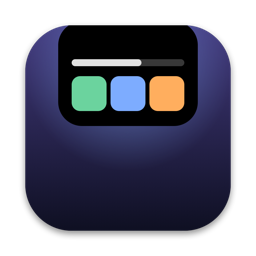
</p>

<h1 align="center">NotchHub</h1>

<p align="center">
  <b>MacBook çentiğin artık canlı bir kontrol merkezi.</b><br>
  Müzik, toplantılar, dosyalar, zamanlayıcılar ve uyarılar, bir fare hareketi uzağında.
</p>

<p align="center">
  <a href="https://github.com/atak946/NotchHub/releases/latest"></a>
  
  
  <a href="LICENSE"></a>
  <a href="https://github.com/atak946/NotchHub/actions/workflows/ci.yml"></a>
  <a href="https://github.com/atak946/NotchHub/releases"></a>
</p>

<p align="center">
  <a href="https://github.com/atak946/NotchHub/releases/latest">
    
  </a>
</p>

<p align="center">
  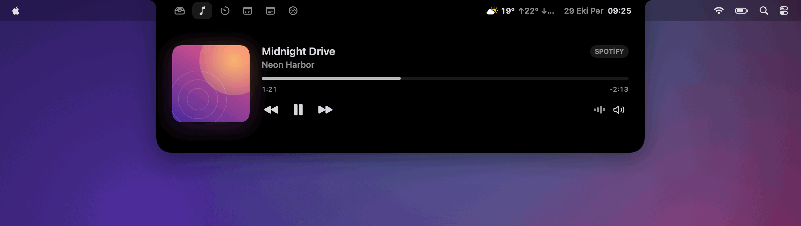
</p>

<p align="center">
  <a href="README.md">English</a> · <b>Türkçe</b>
</p>

---

## ✨ Bir bakışta

Fareyi çentiğe getir, NotchHub açılsın. Uzaklaş, kapansın. Kapalıyken çentiğin iki yanında küçük canlı
göstergeler durur. `⌥⌘N` ile aç / kapat, `⌘1…6` ile sekme değiştir. Çentiği olmayan ekranlarda sanal bir
çentik çıkar.

<table>
  <tr>
    <td width="50%" valign="top">
      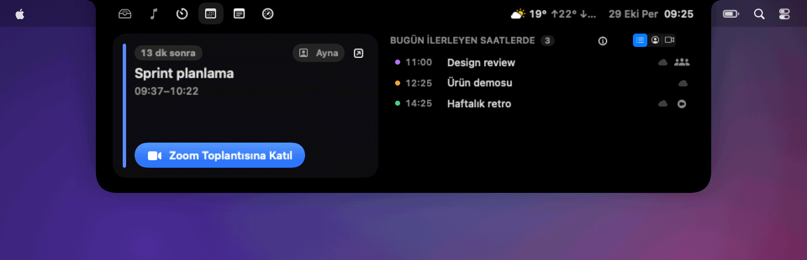
      <h3>📅 Takvim</h3>
      Sıradaki toplantı, tek tıkla Zoom / Teams / Meet'e katıl düğmesi ve günün geri kalanı.
      macOS Takvim, ICS akışları ve Microsoft 365.
    </td>
    <td width="50%" valign="top">
      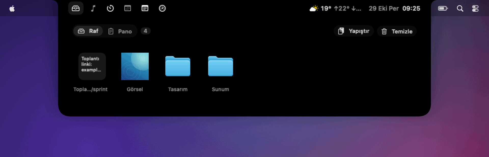
      <h3>🗂️ Dosya rafı</h3>
      Dosya, metin veya görseli çentiğe bırak, sonra geri sürükle. Quick Look, AirDrop ve pano geçmişi
      dahil.
    </td>
  </tr>
  <tr>
    <td width="50%" valign="top">
      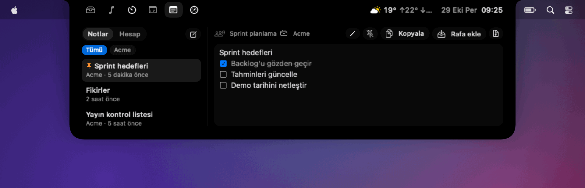
      <h3>📝 Notlar ve hızlı hesap</h3>
      Kontrol listeli düz metin notlar; o anki toplantıyı ve müşteriyi kendisi ekler. Yanında birim ve
      döviz çeviren bir hesap makinesi var.
    </td>
    <td width="50%" valign="top">
      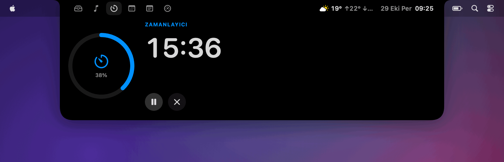
      <h3>⏱️ Zamanlayıcı ve Pomodoro</h3>
      Hazır ve özel süreler, Pomodoro döngüleri; geri sayım kapalı çentiğin yanında görünür.
    </td>
  </tr>
  <tr>
    <td width="50%" valign="top">
      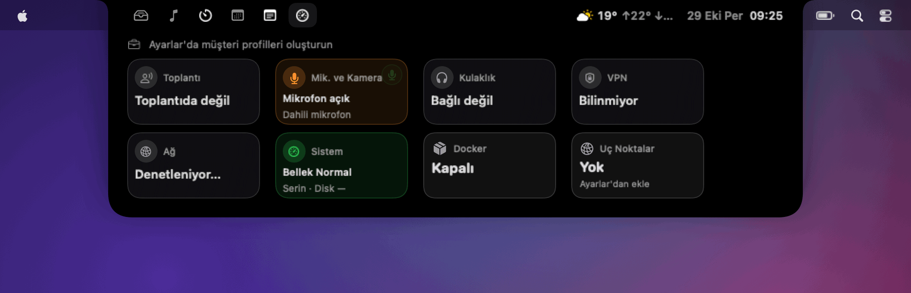
      <h3>📡 Durum</h3>
      Kullanımdaki mikrofon ve kamera, VPN, ağ, bellek ve ısı baskısı, Docker, uç noktalar ve yerel LLM
      sunucusu.
    </td>
    <td width="50%" valign="top">
      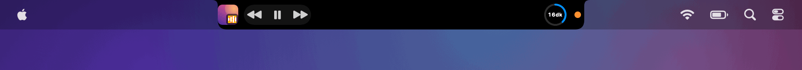
      <h3>🎵 Kapalıyken de canlı</h3>
      Renklendirilmiş görselleştiricili kapak, oynatma kontrolleri, zamanlayıcı ve gizlilik noktası, tam
      çentiğin yanında.
    </td>
  </tr>
</table>

### 🔔 Gizliliğe saygılı bildirimler

Mesaj bildirimleri çentiğe yansıtılabilir. Mesaj metni, **Göster**'e basana kadar gizli kalabilir.

<p align="center">
  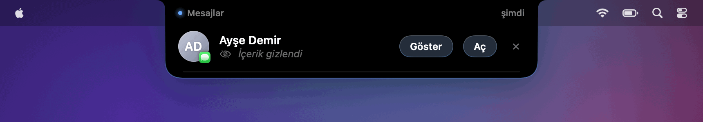
  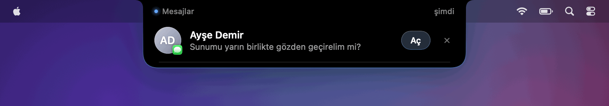
</p>

### 🔋 Pil ve ses, çentik usulü

Şarj, fişten çekme ve düşük pil küçük animasyonlu uyarılarla görünür. Ses ve parlaklık HUD'u büyük sistem
göstergesinin yerini alır.

<p align="center">
  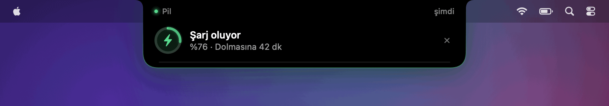
  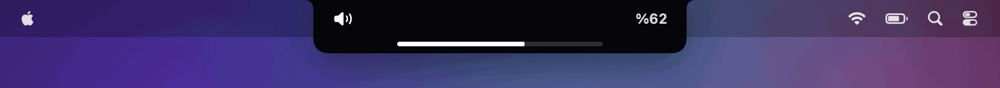
</p>

### ⚙️ Aranabilir ayarlar

Tüm seçenekler aranabilir tek bir pencerede. Bir kelime yaz, eşleşen sayfalar ve seçenekler gelsin.

<p align="center">
  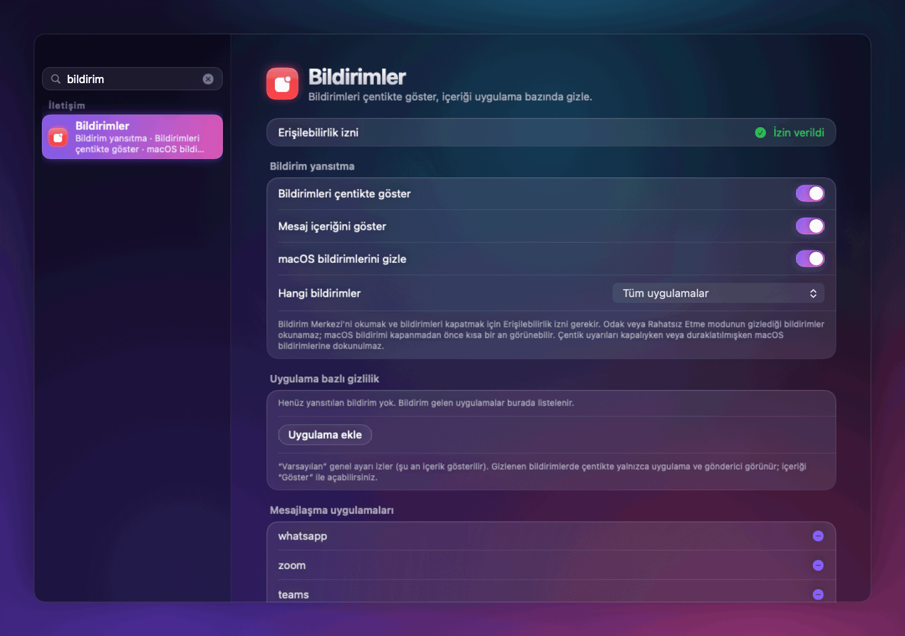
</p>

### 🧰 Dahası

- **Animasyonlu uyarılar:** hatırlatmalar, zamanlayıcılar, sistem olayları ve kendi betiklerin için tek kuyruk.
- **Profiller:** uygulama ve bağlantı açan, VPN'i bekleyen, `docker compose` çalıştıran tek tıklık müşteri profilleri.
- **İçgörüler:** okunmamış rozetleri, müşteri bazlı zaman takibi ve odak koruması.
- **Entegrasyonlar:** `notchhub://` URL şeması, yerel soket, CLI, zsh kancası ve Xcode derleme uyarıları.
- Saatin yanında **hava durumu**, görüntülü görüşmeden önce **kamera aynası**.

Tam liste: [docs/FEATURES.md](docs/FEATURES.md).

## 📦 Kurulum

1. [Releases](https://github.com/atak946/NotchHub/releases/latest) sayfasından son **NotchHub.dmg**'yi indir.
2. Aç ve **NotchHub**'ı **Uygulamalar** klasörüne sürükle.
3. NotchHub'ı başlat. Menü çubuğunda yaşar, Dock ikonu yoktur.

Sürümler imzalı ve Apple tarafından onaylıdır (notarized). NotchHub günde bir kez
[Sparkle](https://sparkle-project.org) ile güncelleme denetler ve bulduğunu çentikte sunar. Her güncelleme
EdDSA imzasıyla doğrulanır. Denetimi Ayarlar'dan kapatabilirsin.

**Gereksinimler:** macOS 26 veya üstü. Çentikli bir Mac önerilir. Uygulama Türkçe ve İngilizce kullanılabilir.

## 🔐 İzinler

macOS her izni, bir özellik ilk kez ihtiyaç duyduğunda sorar. Birini reddedersen yalnızca o özellik kapalı
kalır.

| İzin | Neden gerekli |
|---|---|
| **Takvimler** | Sıradaki toplantı, günün ajandası ve toplantı hatırlatmaları |
| **Otomasyon** (Apple Events) | Spotify ve Müzik'i okumak ve kontrol etmek |
| **Bildirimler** | Zamanlayıcı ve Pomodoro bildirimleri |
| **Erişilebilirlik** | Dock okunmamış rozetleri, zaman takibi için pencere başlıkları ve yansıtma için bildirimleri okumak (isteğe bağlı kapatmak) |
| **Konum** (isteğe bağlı) | Bulunduğun şehrin hava durumu (ya da elle şehir seç) ve ağ değişikliği uyarıları için Wi-Fi adı |
| **Giriş öğesi** | "Girişte başlat" |

Mikrofon ve kameranın *kullanımda olması* CoreAudio / CoreMediaIO durumundan anlaşılır. NotchHub asla ses
veya görüntü kaydetmez.

## 🛡️ Gizlilik

- **Yalnızca yerel.** Raf öğeleri, notlar, zaman takibi ve ayarlar Mac'inde kalır. Takvim gizli bilgileri
  (ICS bağlantıları, Microsoft jetonları) Anahtar Zinciri'nde tutulur.
- **Yansıtılan bildirimler** Erişilebilirlik API'siyle okunur, çentikte gösterilir ve sonra unutulur.
  Yansıtmayı mesajlaşma uygulamalarıyla sınırlayabilir veya mesaj metnini gizleyebilirsin.
- **Telemetri yok.** Analitik ve takip yok. Hakkında otomatik olarak hiçbir şey gönderilmez.
- **Ağ istekleri yalnızca kullandığın özellikler için yapılır:**
  - [Open-Meteo](https://open-meteo.com)'dan hava durumu, koordinatlar yaklaşık 1 km'ye yuvarlanır (kapatılabilir);
  - senin eklediğin ICS akışları, Microsoft 365, uç nokta denetimleri ve yerel LLM sunucusu;
  - yalnızca bu projenin GitHub Releases appcast'ini indiren güncelleme denetimi.

## 🛠️ Kaynaktan derleme

```bash
brew install xcodegen
xcodegen generate
xcodebuild -project NotchHub.xcodeproj -scheme NotchHub -derivedDataPath build build
open build/Build/Products/Debug/NotchHub.app
```

İmzalama, yerel yapılandırma, CLI, sürüm çıkarma ve ekran görüntülerinin nasıl üretildiği
[docs/DEVELOPMENT.md](docs/DEVELOPMENT.md) içinde (İngilizce).

## 🤝 Katkı

Issue ve pull request'ler memnuniyetle karşılanır. Bkz. [CONTRIBUTING.md](CONTRIBUTING.md). Güvenlik
sorunlarını bildirmek için [SECURITY.md](SECURITY.md).

## 📄 Lisans

[MIT](LICENSE)
